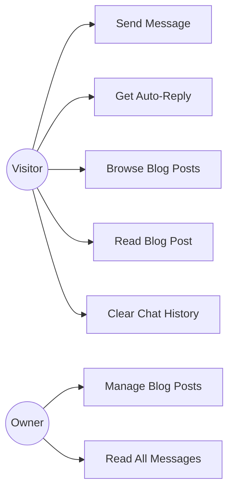
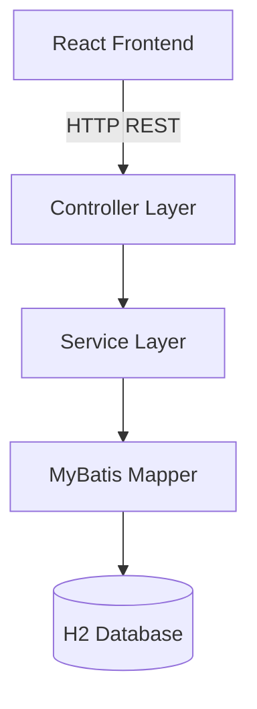

# Portfolio Backend API — Requirements

## 1. Project Vision

Provide a backend API for Kewei's portfolio website. It supports two core features: instant messaging (so visitors can leave real messages) and blog content management (so posts are stored in a database, not hardcoded).

## 2. Stakeholders

| Stakeholder | Role |
|-------------|------|
| Kewei (Owner) | Developer of frontend and backend; wants a working portfolio |
| Visitor | Anyone who visits the portfolio website |
| UL Lecturer | Reviews the project for CS5709 assessment |

## 3. Personas

**Visitor (Emma)** — A recruiter browsing the portfolio. She wants to ask about experience via chat and read blog posts. Not technical.

**Owner (Kewei)** — The portfolio owner. He wants to manage blog posts (add, edit, delete) and read visitor messages.

## 4. Scenarios

**S1: Visitor sends a message** — Emma types "hello" in the chat widget and gets an instant auto-reply. Her message is saved to the database.

**S2: Owner manages blog posts** — Kewei creates a new blog post with title and content. The post appears on the frontend Blog page.

**S3: Visitor reads blog** — Emma opens the Blog page, sees the post list, and clicks one to read the full content.

## 5. User Stories

| ID | Story |
|----|-------|
| US1 | As a visitor, I want to send a message in the chat, so that I can contact the owner. |
| US2 | As a visitor, I want to receive an auto-reply, so that I know my message was received. |
| US3 | As a visitor, I want to see my chat history, so that I can review what I asked. |
| US4 | As the owner, I want to read all visitor messages, so that I can respond to them. |
| US5 | As the owner, I want to create, edit and delete blog posts, so that I can keep content fresh. |
| US6 | As a visitor, I want to browse blog posts, so that I can read the owner's articles. |

## 6. Functional Requirements

| ID | Requirement |
|----|-------------|
| FR1 | The system shall save visitor messages to the database. |
| FR2 | The system shall generate an auto-reply based on keywords. Rules migrate from frontend `REPLY_RULES` (useChat.ts) to backend; frontend stops generating replies. |
| FR3 | The system shall return chat history by visitor session. |
| FR4 | The system shall return all messages for the owner. |
| FR5 | The system shall support CRUD on blog posts (create, read, update, delete). |
| FR6 | The system shall validate request input (non-empty text, valid IDs). |
| FR7 | The system shall return proper HTTP status codes (200, 201, 204, 400, 401, 404). |
| FR8 | The system shall delete chat history by session (matches frontend `clearMessages`). |
| FR9 | Owner-only endpoints (POST/PUT/DELETE /posts, GET /messages/all) shall require an admin token in the `X-Admin-Token` header. The token is a single password stored in application config. |
| FR10 | Input validation: `text` non-empty and <= 1000 chars; `title` non-empty and <= 200 chars; `excerpt` <= 500 chars; `sessionId` non-empty. |

## 7. Non-Functional Requirements

| ID | Requirement |
|----|-------------|
| NFR1 | API response time under 500ms for read operations. |
| NFR2 | Data must persist across server restarts (H2 file mode). |
| NFR3 | Automated tests shall follow `requirements/Non-functional requirements/unit-testing-strategy-and-standards.md`. |
| NFR4 | Code shall follow `requirements/Non-functional requirements/Alibaba-Java-Coding-Guidelines.md`. |
| NFR5 | The API shall allow CORS from the frontend origin (React dev server), so the frontend can call the API directly. |

## 8. Use Case Diagram



## 9. System Architecture



Three layers:
- **Controller** — handles HTTP request/response and validation
- **Service** — business logic (auto-reply, post management)
- **Mapper** — data access via MyBatis to H2 database

## 10. Database Design

**Table: messages**

| Column | Type | Description |
|--------|------|-------------|
| id | BIGINT AUTO_INCREMENT | Primary key |
| session_id | VARCHAR(64) | Visitor session identifier |
| sender | VARCHAR(10) | 'user' or 'bot' |
| content | VARCHAR(1000) | Message text (maps to API field `text`) |
| created_at | TIMESTAMP | When the message was sent |

**Table: blog_posts**

| Column | Type | Description |
|--------|------|-------------|
| id | BIGINT AUTO_INCREMENT | Primary key |
| post_date | VARCHAR(10) | Publish date yyyy-MM-dd (maps to API field `date`) |
| title | VARCHAR(200) | Post title |
| excerpt | VARCHAR(500) | Short summary |
| content | CLOB | Full article content |
| created_at | TIMESTAMP | When the post was created |

## 11. API Specification

Base URL: `/api/v1`

> **Note:** `sessionId` is generated by the frontend (UUID stored in localStorage) to identify each visitor's chat session.

> **Auth:** Endpoints marked with **[Admin]** require the `X-Admin-Token` header. The token is a single password set in application config. Missing or wrong token returns `401`.

### Messages

| Method | Path | Description | Request Body | Response |
|--------|------|-------------|--------------|----------|
| POST | /messages | Send message, get auto-reply | `{ "sessionId": "...", "text": "..." }` | `{ "userMessage": { "id": 1, "text": "...", "sender": "user" }, "botMessage": { "id": 2, "text": "...", "sender": "bot" } }` |
| GET | /messages?sessionId={id} | Get chat history by session | — | `[{ "id": 1, "text": "...", "sender": "user" }, ...]` |
| GET | /messages/all | **[Admin]** Get all messages | — | `[{ "id": 1, "sessionId": "...", "text": "...", "sender": "user", "createdAt": "..." }, ...]` |
| DELETE | /messages?sessionId={id} | Clear chat history by session | — | `204 No Content` |

### Blog Posts

| Method | Path | Description | Request Body | Response |
|--------|------|-------------|--------------|----------|
| GET | /posts | List all posts (no content) | — | `[{ "id": 1, "date": "...", "title": "...", "excerpt": "..." }, ...]` |
| GET | /posts/{id} | Get one post with full content | — | `{ "id": 1, "date": "...", "title": "...", "excerpt": "...", "content": "..." }` |
| POST | /posts | **[Admin]** Create a post | `{ "date": "...", "title": "...", "excerpt": "...", "content": "..." }` | `201` + created post |
| PUT | /posts/{id} | **[Admin]** Update a post | `{ "date": "...", "title": "...", "excerpt": "...", "content": "..." }` | updated post |
| DELETE | /posts/{id} | **[Admin]** Delete a post | — | `204 No Content` |

### Error Response Format

All errors return a JSON body:

```json
{
  "status": 404,
  "error": "Not Found",
  "message": "Post not found"
}
```

| Status | When |
|--------|------|
| 400 | Validation failed (empty text, title too long) |
| 401 | Missing or wrong `X-Admin-Token` |
| 404 | Post or message not found |
| 500 | Unexpected server error |
